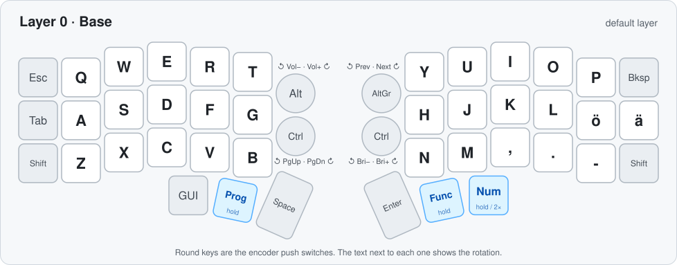

# Corne Choc Pro Keymap Implementation

This document describes how [`config/corne_choc_pro.keymap`](config/corne_choc_pro.keymap) makes the layout.
For images of each layer, see [corne_layout_visualization.md](corne_layout_visualization.md).

## Layers

The keymap has nine layers.

| Index | Define | Display name | How to get to it |
|-------|--------|--------------|------------------|
| 0 | `BASE` | Base | Default layer. `&to BASE` from the keyboard layer. |
| 1 | `NUMBER` | Number | `&td_num` on the right thumb |
| 2 | `FUNCTION` | Function | `&mo FUNCTION` on the right thumb |
| 3 | `PROG` | Programming | `&mo PROG` on the left thumb |
| 4 | `BASE_MAC` | Base Mac | `&to BASE_MAC` from the keyboard layer |
| 5 | `NUMBER_MAC` | Number Mac | `&td_num_mac` on the right thumb |
| 6 | `FUNCTION_MAC` | Function Mac | `&mo FUNCTION_MAC` on the right thumb |
| 7 | `PROG_MAC` | Programming Mac | `&mo PROG_MAC` on the left thumb |
| 8 | `KEYBOARD` | Keyboard | A three-key combo on the thumb keys |

The thumb keys of the Mac base layer point to the Mac layers. Thus one `&to` binding changes the full set of layers.

## Key positions

The keymap has 46 positions.

| Positions | Keys |
|-----------|------|
| 0 to 13 | Top row. Positions 6 and 7 are the inner keys `Alt` and `AltGr`. |
| 14 to 27 | Home row. Positions 20 and 21 are the two inner `Ctrl` keys. |
| 28 to 39 | Bottom row |
| 40 to 42 | Left thumb keys: `GUI`, `Prog`, `Space` |
| 43 to 45 | Right thumb keys: `Enter`, `Func`, `Num` |

## Behaviors

### Tap dances

`td_num` and `td_num_mac` have a tapping term of 200 ms.

| Action | Binding | Result |
|--------|---------|--------|
| One tap or hold | `&mo NUMBER` | The number layer is on while you hold the key. |
| Two taps | `&tog NUMBER` | The number layer stays on. |

Position 45 on the number layer is `&tog NUMBER`. This key sets the locked layer off.

### Combos

Both combos have a timeout of 50 ms and the binding `&tog KEYBOARD`.

| Combo | Positions | Keys |
|-------|-----------|------|
| `combo_keyboard_layer_left` | 40 41 42 | `GUI` + `Prog` + `Space` |
| `combo_keyboard_layer_right` | 43 44 45 | `Enter` + `Func` + `Num` |

Three keys are necessary so that you do not open the keyboard layer by accident.

### Macros

| Macro | Sends |
|-------|-------|
| `arrow`, `mac_arrow` | `=>` |
| `layer_indicator_win` | Goes to `BASE`, then types `win-mode ` |
| `layer_indicator_mac` | Goes to `BASE_MAC`, then types `mac-mode ` |

## Sensor bindings

This keyboard has no encoders. The four inner positions have switches.
The board files define four encoders, and the two base layers keep these sensor bindings for them. The bindings do nothing without encoders.

| Sensor | Binding |
|--------|---------|
| `left_ex1_encoder` | `&inc_dec_kp C_VOL_DN C_VOL_UP` |
| `left_ex2_encoder` | `&inc_dec_kp PG_UP PG_DN` |
| `right_ex1_encoder` | `&inc_dec_kp C_PREV C_NEXT` |
| `right_ex2_encoder` | `&inc_dec_kp C_BRI_DN C_BRI_UP` |

## Key headers

The keymap does not use the ZMK key names for characters. It uses two headers that give each character the key code that the Finnish OS layout needs.

| Header | Prefix | Use |
|--------|--------|-----|
| [`config/keys_fi.h`](config/keys_fi.h) | `FI_` | Windows and Linux with the Finnish layout. Symbols use AltGr. |
| [`config/keys_fi_mac.h`](config/keys_fi_mac.h) | `FI_MAC_` | macOS with the Finnish layout. Symbols use Option. |

For example, `FI_AT` is AltGr+2 and `FI_DLLR` is AltGr+4.

## Files

| File | Use |
|------|-----|
| `config/corne_choc_pro.keymap` | The keymap that the build uses |
| `config/corne_choc_pro.json` | Key positions for layout tools and for the image script |
| `boards/arm/corne_choc_pro/` | Board definition. Its `.keymap` file is the board default. The file in `config/` replaces it. |
| `build.yaml` | The list of firmware files to build |
| `config/west.yml` | ZMK version and modules |

## Build

`build.yaml` builds four firmware files:

- `corne_choc_pro_left` and `corne_choc_pro_right` with the `nice_view` shield
- `corne_choc_pro_left` and `corne_choc_pro_right` with the `settings_reset` shield

All four use the `studio-rpc-usb-uart` snippet. The left half has `CONFIG_ZMK_STUDIO=y`.

If you change keys in ZMK Studio, the keyboard uses those changes and not the keymap file. Then the images in this repository can be different from the keyboard.
