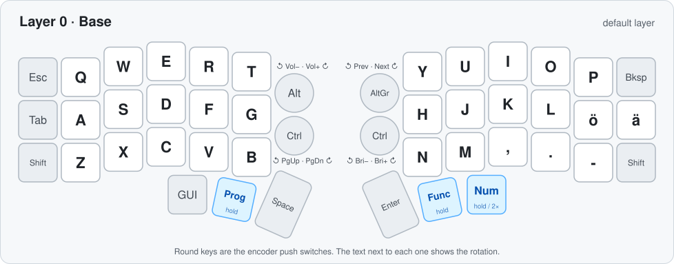
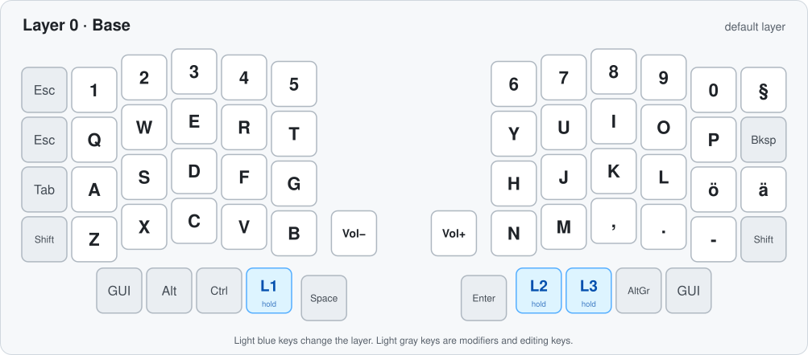

# Keyboard Config - Corne Choc Pro and Sofle

[](https://github.com/mkajander/zmk-config/actions/workflows/build.yml)

Personal layouts for two split keyboards. The layouts are for programming in C#, TypeScript, and JavaScript with the Finnish OS keyboard layout.

| Keyboard | Firmware | Layout file | Layout images |
|----------|----------|-------------|---------------|
| Corne Choc Pro | ZMK | [`config/corne_choc_pro.keymap`](config/corne_choc_pro.keymap) | [corne_layout_visualization.md](corne_layout_visualization.md) |
| Sofle | Vial | [`current-sofle.vil`](current-sofle.vil) | [SOFLE_LAYOUT_VISUALIZATION.md](SOFLE_LAYOUT_VISUALIZATION.md) |

The two keyboards use the same layer design, so most symbols are in the same places on both.

## Corne Choc Pro



| Layer | Contents | How to get to it |
|-------|----------|------------------|
| Base | QWERTY with `ö` and `ä` | Default layer |
| Number | Numbers, math operators, `<=` `>=` `!=`, `€ $ §` | Hold `Num`. Double tap `Num` to lock the layer. |
| Function | `F1` to `F12`, arrows, page navigation, undo and redo | Hold `Func` |
| Programming | `{ } [ ] ( ) < >` and the other programming symbols | Hold `Prog` |
| Keyboard | Bluetooth, RGB, reset, bootloader, OS mode | Press all three thumb keys of one hand |

See [corne_layout_visualization.md](corne_layout_visualization.md) for an image of each layer.
See [KEYMAP_IMPLEMENTATION.md](KEYMAP_IMPLEMENTATION.md) for the behaviors, combos, and macros.

### Windows/Linux mode and Mac mode

The Finnish layout on macOS puts some symbols on different keys than Windows and Linux. The keymap has two sets of layers for this reason:

- **Windows/Linux mode** uses layers 0 to 3. Symbols use AltGr. For example, `@` is AltGr+2.
- **Mac mode** uses layers 4 to 7. Symbols use Option. For example, `@` is Option+2.

The two modes make the same characters. Set the OS keyboard layout to Finnish in both modes.

To change the mode:

1. Press all three thumb keys of one hand at the same time. This opens the keyboard layer.
2. Press `Win` or `Mac` on the top row.

To see which mode is on, press `Win` or `Mac` on the home row of the keyboard layer. The key selects the mode and types `win-mode` or `mac-mode`.

The mode stays until you change it. The keymap does not save the mode, so the keyboard starts in Windows/Linux mode after a restart.

### Build and flash

1. Open the **Actions** tab and run the **Build ZMK firmware** workflow. The workflow does not start on a push.
2. Download the firmware artifact from the workflow run. It contains a `.uf2` file for each half.
3. Connect the left half with USB and put it into bootloader mode. The `Boot` key on the keyboard layer does this for the left half.
4. Copy the `.uf2` file for the left half to the USB drive that appears.
5. Do steps 3 and 4 for the right half with its `.uf2` file. Use the reset button to get to bootloader mode.

The artifact also has `settings_reset` firmware. Flash it to both halves if the halves do not connect to each other. Then flash the usual firmware again.

## Sofle



To put the layout on the keyboard, open Vial and load `current-sofle.vil` with **File > Load saved layout**.
After you change the layout in Vial, save it to `current-sofle.vil` and commit it. The keyboard has the only other copy.

See [SOFLE_LAYOUT_VISUALIZATION.md](SOFLE_LAYOUT_VISUALIZATION.md) for an image of each layer.

## Layout images

Two scripts make the images in `images/` from the layout files. They need Python 3 and no other packages.

```
python scripts/render_corne_layout.py
python scripts/render_sofle_layout.py
```

Run the applicable script after you change a layout, and commit the images with the layout.
