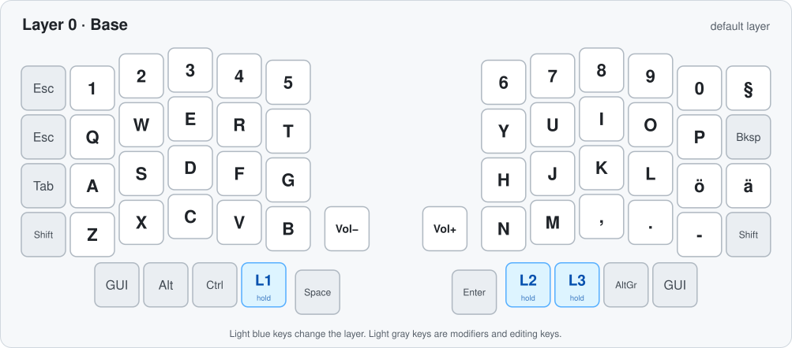
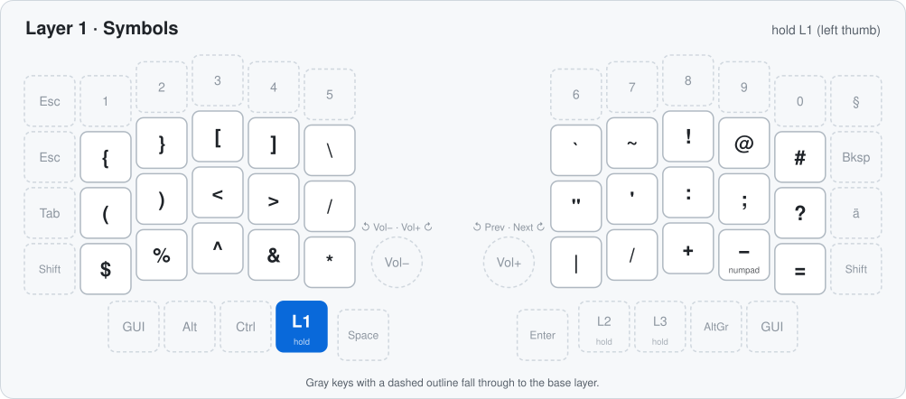
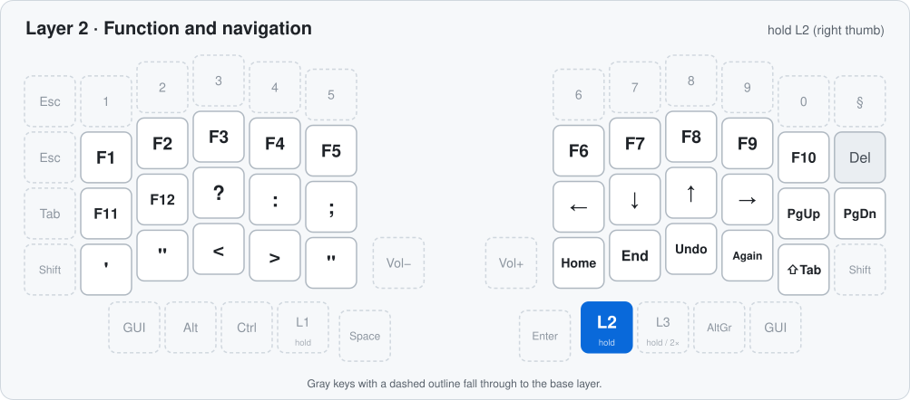
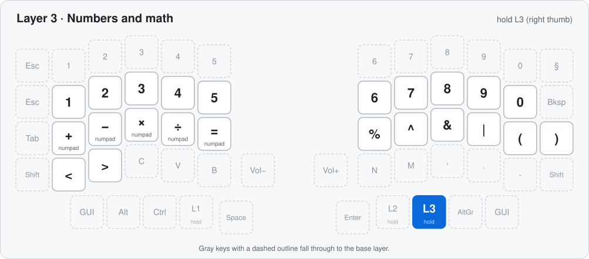
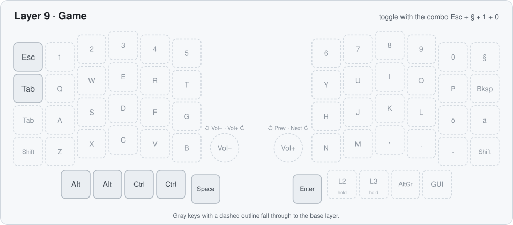

# Sofle Keyboard - Layout Visualization

This document shows the Sofle layout that is in [`current-sofle.vil`](current-sofle.vil).
The Sofle uses Vial firmware. To put the layout on the keyboard, load the file in Vial with **File > Load saved layout**.

The images show the characters that the Finnish OS keyboard layout makes.
On a different OS layout, the symbol keys make different characters.

## How to read the images

- A white key sends the character or the function on its legend.
- A light gray key is a modifier or an editing key.
- A light blue key changes the layer. The dark blue key is the key that you hold for the layer in the image.
- A gray key with a dashed outline has no assignment on that layer. It does the same as on the base layer.
- A round key is an encoder push switch. The text above it shows what the encoder sends when you turn it.

## Layers

| Layer | Name | How to get to it |
|-------|------|------------------|
| 0 | Base | Default layer |
| 1 | Symbols | Hold `L1` on the left thumb |
| 2 | Function and navigation | Hold `L2` on the right thumb |
| 3 | Numbers and math | Hold `L3` on the right thumb |
| 9 | Game | Press Esc + § + 1 + 0 at the same time. Do it again to go back. |

Layers 4 to 8 are empty.

### Layer 0: Base

- QWERTY with a number row.
- `Esc` is on the two top keys of the left outer column.
- `L1`, `L2`, and `L3` change the layer only while you hold them. They send nothing when you tap them.
- The base layer has no `å` key.

### Layer 1: Symbols

- The left hand has the brackets in pairs: `{ }`, `[ ]`, `( )`, and `< >`.
- The right hand has punctuation on the home row and operators on the bottom row.
- `^`, `~`, and `` ` `` are dead keys in the Finnish OS layout. Press `Space` after them to get the character alone.

### Layer 2: Function and navigation

- `F1` to `F10` are on the top letter row. `F11` and `F12` are on the left home row.
- The arrow keys are on the right home row in the order left, down, up, right.
- `Home`, `End`, `Undo`, `Again`, and Shift+Tab are below the arrow keys.
- `PgUp`, `PgDn`, and `Del` are in the two right outer columns.
- The left hand has `? : ;`, the quote characters, and `< >`.

### Layer 3: Numbers and math

- The numbers are on the top letter row, one row below the number row.
- The left home row has the numeric keypad operators.
- The right home row has `% ^ & | ( )`.

### Layer 9: Game

- The left thumb keys are `Alt`, `Alt`, `Ctrl`, `Ctrl`, and `Space`. This layer has no `L1` key and no left `GUI` key.
- `Tab` replaces the second `Esc` in the left outer column.
- `L2` and `L3` on the right thumb continue to work.

## Encoders

| Encoder | Turn left | Turn right | Push |
|---------|-----------|------------|------|
| Left | Volume down | Volume up | Volume down |
| Right | Previous track | Next track | Volume up |

The encoders do the same on all layers.

## Combos and tap dances

- **Combo 0:** Esc + § + 1 + 0 toggles layer 9. These are the four corner keys of the number row.
- **Tap dance 3:** hold for layer 3, double tap to toggle layer 3. The file defines this tap dance, but no key uses it.

## Update the images

The script [`scripts/render_sofle_layout.py`](scripts/render_sofle_layout.py) makes the images from `current-sofle.vil`.
It needs Python 3 and no other packages.

1. Save the layout in Vial to `current-sofle.vil`.
2. Run `python scripts/render_sofle_layout.py`.
3. If the layers changed, update the layer names in `LAYERS` at the top of the script and the notes in this document.
4. Commit the `.vil` file and the files in `images/sofle/`.

The script stops with an error if the layout has a keycode that the script cannot name.
Add the keycode to the tables at the top of the script.
