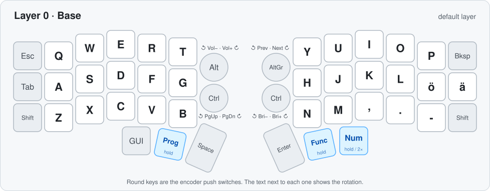
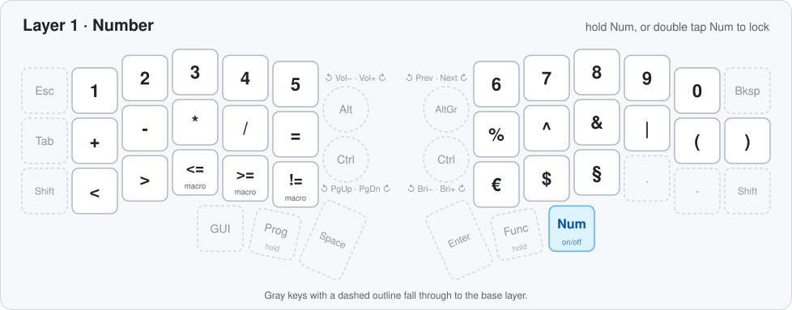
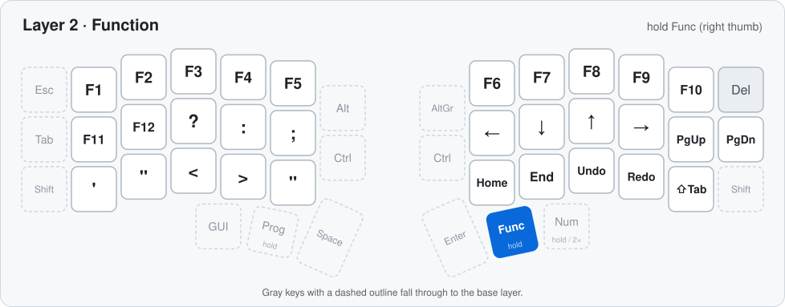
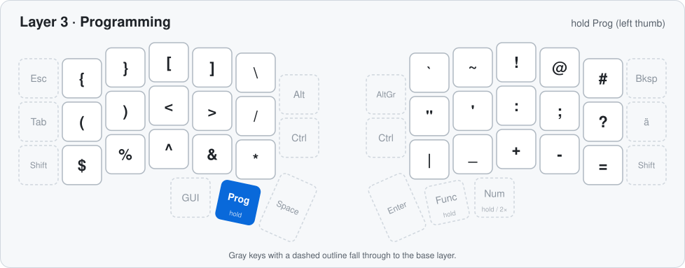
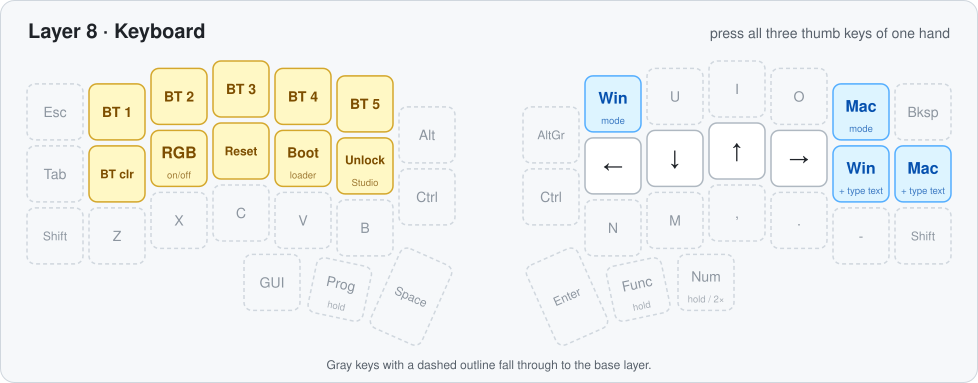

# Corne Choc Pro - Layout Visualization

This document shows the Corne Choc Pro layout that is in [`config/corne_choc_pro.keymap`](config/corne_choc_pro.keymap).
The Corne Choc Pro uses ZMK firmware.

The images show the characters that the keys make when the OS keyboard layout is Finnish.

## How to read the images

- A white key sends the character or the function on its legend.
- A light gray key is a modifier or an editing key.
- A light blue key changes the layer. The dark blue key is the key that you hold for the layer in the image.
- A yellow key is a keyboard function, for example a Bluetooth profile.
- A gray key with a dashed outline has no assignment on that layer. It does the same as on the base layer.

## Layers

| Layer | Name | How to get to it |
|-------|------|------------------|
| 0 | Base | Default layer |
| 1 | Number | Hold `Num`. Double tap `Num` to lock the layer. |
| 2 | Function | Hold `Func` on the right thumb |
| 3 | Programming | Hold `Prog` on the left thumb |
| 4 to 7 | Mac versions of layers 0 to 3 | Press `Mac` on the keyboard layer |
| 8 | Keyboard | Press all three thumb keys of one hand at the same time |

### Layer 0: Base

- QWERTY with `ö` and `ä` on the right home row.
- The four keys of the inner column are `Alt`, `Ctrl`, `AltGr`, and `Ctrl`. This keyboard has switches in these positions, not encoders.
- `Prog` and `Func` change the layer only while you hold them.

### Layer 1: Number

- The numbers are on the top row.
- The left home row has the math operators. The right home row has `% ^ & | ( )`.
- `=>` is a macro. It sends the two characters `=` and `>`.
- When the layer is locked, press `Num` to go back to the base layer.

### Layer 2: Function

- `F1` to `F10` are on the top row. `F11` and `F12` are on the left home row.
- The arrow keys are on the right home row in the order left, down, up, right.
- `Home`, `End`, `Undo`, `Redo`, and Shift+Tab are on the right bottom row.
- The left hand has `? : ;`, the quote characters, and `< >`.

### Layer 3: Programming

- The left hand has the brackets in pairs: `{ }`, `[ ]`, `( )`, and `< >`.
- The right hand has punctuation on the home row and operators on the bottom row.
- `^`, `~`, and `` ` `` are dead keys in the Finnish OS layout. Press `Space` after them to get the character alone.

### Layer 8: Keyboard

- `BT 1` to `BT 5` select a Bluetooth profile. `BT clr` removes the pairing of the current profile.
- `RGB` sets the underglow on or off.
- `Reset` restarts the left half. `Boot` puts the left half into bootloader mode.
- `Unlock` lets ZMK Studio change the keymap.
- The top `Win` and `Mac` keys select the OS mode.
- The `Win` and `Mac` keys on the home row select the OS mode and then type `win-mode` or `mac-mode`. Use them to see which mode is on.
- To leave the layer, press the three thumb keys again, or select an OS mode.

## Mac layers

Layers 4 to 7 have the same legends as layers 0 to 3. They send the key codes that the macOS Finnish layout needs for the same characters.
There is one difference in function: `Undo` and `Redo` send Cmd+Z and Cmd+Shift+Z.

The script that makes the images compares the Mac layers with layers 0 to 3. It stops with an error if a legend is different.

## Update the images

The script [`scripts/render_corne_layout.py`](scripts/render_corne_layout.py) makes the images.
It reads the bindings from `config/corne_choc_pro.keymap` and the key positions from `config/corne_choc_pro.json`.
It needs Python 3 and no other packages.

1. Change the keymap.
2. Run `python scripts/render_corne_layout.py`.
3. If the layers changed, update `LAYERS` at the top of the script and the notes in this document.
4. Commit the keymap and the files in `images/corne/`.

The script stops with an error if the keymap has a binding that the script cannot name.
Add the binding to the tables at the top of the script.
